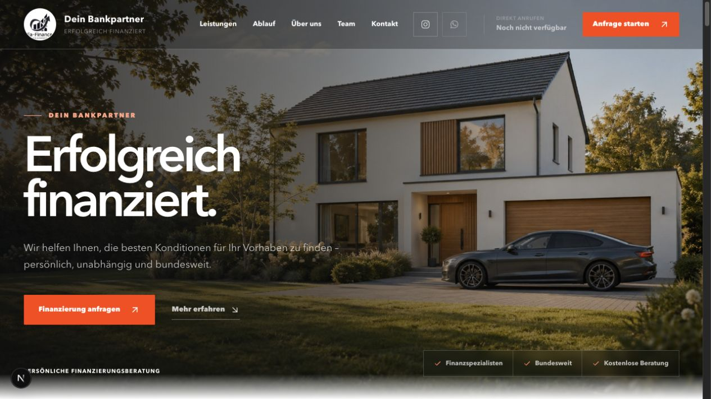
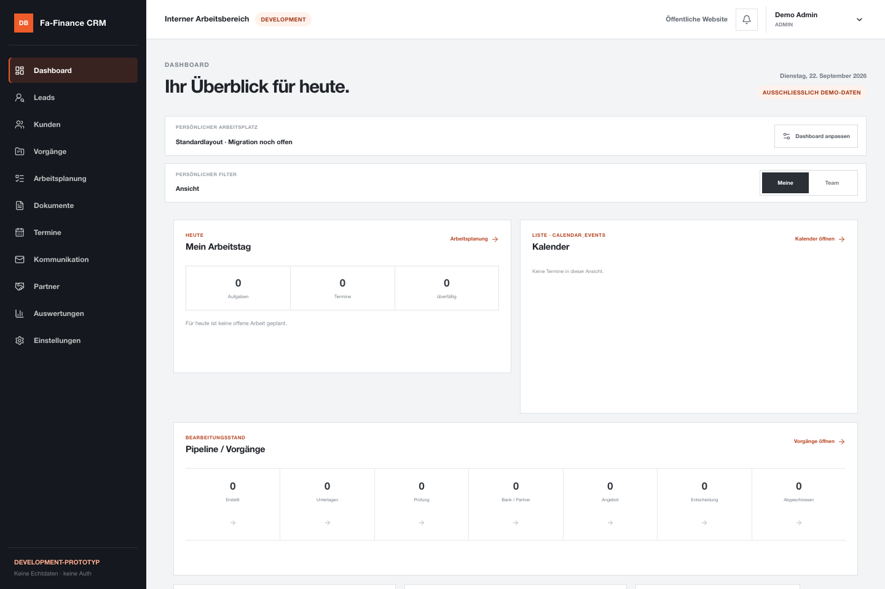

# FA Finance

### Vom digitalen Erstkontakt zur strukturierten CRM-Bearbeitung

Eine Fallstudie von **Cem Bagana** zu Produktmanagement, Prozessgestaltung und technischer Umsetzung.

[Portfolio](https://www.cembagana.de/) · [LinkedIn](https://www.linkedin.com/in/cem-bagana/) · [GitHub-Profil](https://github.com/cembagana62-jpg)

## Die Aufgabe

Finanzierungsanfragen brauchen einen verständlichen Einstieg und einen nachvollziehbaren Bearbeitungsweg. Ziel des Projekts ist es, Website, Anfrageformulare und interne Kundenverwaltung als zusammenhängendes Produkt zu gestalten: Welche Angaben werden benötigt? Wer übernimmt den nächsten Schritt? Wo bleibt der Bearbeitungsstand sichtbar?

## Mein Beitrag

- **Produktmanagement und Prozessanalyse:** den Weg vom ersten Interesse bis zur internen Bearbeitung strukturieren.
- **Anforderungsdefinition:** benötigte Informationen, Zuständigkeiten und Bearbeitungsschritte zusammenführen.
- **UX/UI und Konzeption:** Website, geführte Anfragewege und CRM-Oberflächen gestalten.
- **Technische Umsetzung:** Website und CRM entwickeln sowie Aufgaben- und Kommunikationsabläufe vorbereiten.
- **Testing und Qualitätssicherung:** Oberflächen und Nutzerführung im Entwicklungsprozess prüfen.

Die Angaben zu meinem Beitrag entsprechen meiner bestehenden Portfolio-Fallstudie.

## Die Lösung im Überblick

| Bereich | Gezeigter Ansatz |
| --- | --- |
| Website | Leistungsübersicht und direkter Einstieg in eine Finanzierungsanfrage |
| Anfrage | Geführte Erfassung von Finanzierungsart, Vorhaben und Erstkontaktangaben |
| Partner | Separater Anfrageweg für mögliche Kooperationen |
| CRM | Zusammenhängende Bereiche für Leads, Kunden, Vorgänge, Aufgaben und Dokumente |
| Koordination | Oberflächen für Team, Partner, Kommunikation und Auswertungen |

### Website

*Aufnahme der lokalen Website vom 27.09.2026. Sie zeigt den damaligen Entwicklungsstand.*

### CRM-Arbeitsbereich

*Lokale Entwicklungsoberfläche mit ausdrücklicher Demo-Kennzeichnung. Die Darstellung enthält keine realen Kundenvorgänge; sichtbare Werte sind keine Geschäftsergebnisse.*

## Der geplante durchgängige Ablauf

**Website-Anfrage → Lead im CRM → Zuständigkeit und Aufgabe → Unterlagen und Kommunikation → Bearbeitung und Auswertung**

Die einzelnen Oberflächen machen diesen Ablauf anschaulich. Die Darstellung ist kein Nachweis einer bereits produktiv verbundenen Verarbeitungskette.

## Entwicklungsstand und nächste Schritte

**Dokumentiert:** Website-Oberflächen, zwei geführte Anfragewege und ein CRM-Arbeitsbereich sind in der vorhandenen Portfolio-Fallstudie beschrieben und durch lokale Aufnahmen illustriert.

**Im dokumentierten Stand noch vor dem Go-live:** produktive Übermittlung, dauerhafte Speicherung und automatischer E-Mail-Versand. Ob diese Punkte inzwischen abgeschlossen sind, wurde für diese Veröffentlichung nicht technisch nachgeprüft.

Die Screenshots stammen aus September 2026. Diese Fallstudie wurde am **20.10.2026** anhand der vorhandenen Projekt- und Portfolio-Dokumentation zusammengestellt. Sie bestätigt weder einen aktuellen Livebetrieb noch bestimmte Leistungs-, Sicherheits- oder Geschäftsergebnisse.

## Was diese Arbeitsprobe zeigt

Die Arbeitsprobe veranschaulicht, wie ich fachliche Anforderungen in einen verständlichen digitalen Ablauf und zusammenhängende Oberflächen übersetze. Im Mittelpunkt stehen die Verbindung von Kundenperspektive und interner Bearbeitung sowie die klare Trennung von entwickelter Oberfläche und noch zu verifizierender produktiver Anbindung.

## Umfang dieser Veröffentlichung

Dieses Repository enthält die Projektvorstellung und ausgewählte Portfolio-Aufnahmen. Der geschäftliche Anwendungsquellcode und interne Unterlagen sind nicht Bestandteil dieser Veröffentlichung.

Weitere Einblicke: [cembagana.de](https://www.cembagana.de/).
